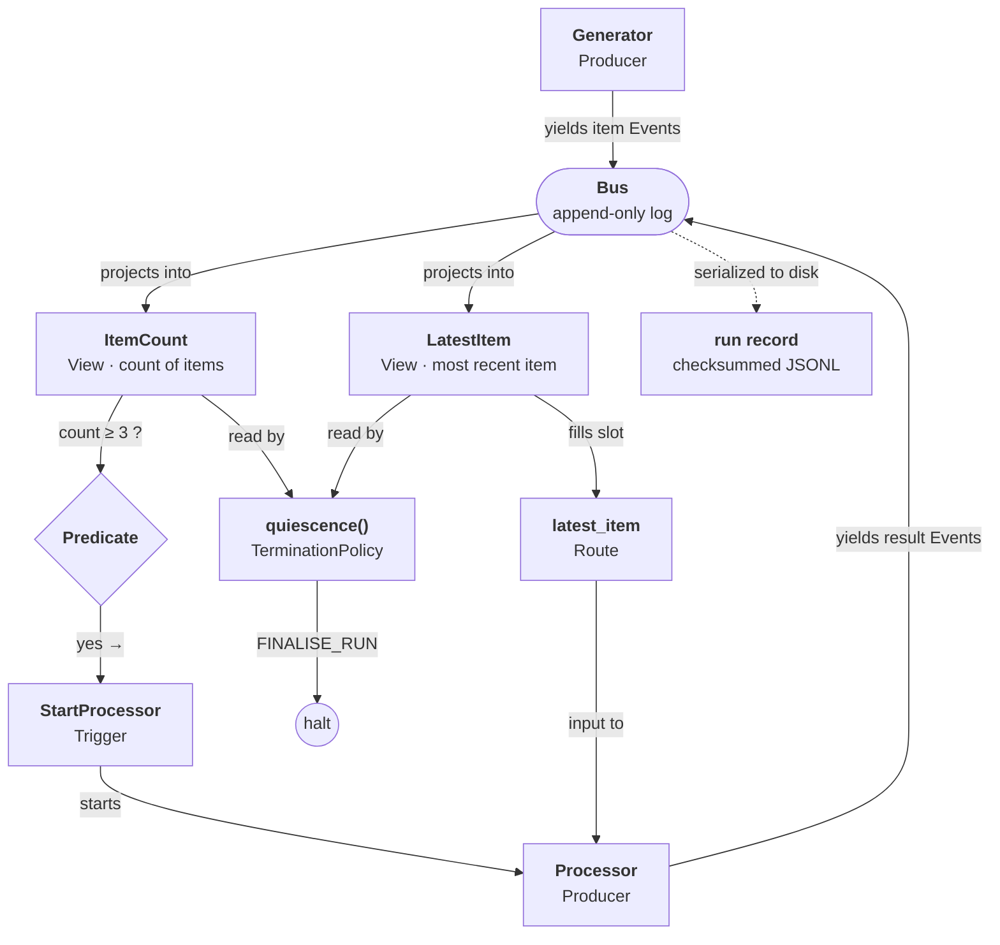

# Substrate


[](https://pypi.org/project/substrate-kernel/)
[](LICENSE)
[](pyproject.toml)

A Python runtime that coordinates concurrent computations through a single append-only log. A topology declares the computations and the conditions that connect them. The log records every output, every lifecycle transition, every decision the runtime made. 

```
pip install substrate-kernel
substrate demo replay code_review
```

## The nine pieces

A topology in Substrate is a function that declares which computations run and what connects them. They are built of nine fundamental ideas.

A **Producer** takes typed input and yields typed output. The runtime treats it as opaque — it sees the input, the output,and nothing between.

An **Event** is one typed, immutable record. Producers produce Events.

The **Bus** is the ordered log of Events. Producers write only to the bus. 

A **View** is any projection of the Bus: a count, a filtered list, or the latest value of some kind. 

A **Predicate** examines the Views and returns yes or no given some condition. 

A **Trigger** watches the Bus and starts a new Producer when its Predicate passes. 

A **Route** subscribes to the Bus much like a View does, but instead of projecting a summary it extracts values and stages them as input for future producers.  

A **TerminationPolicy** decides ending conditions: count events, pause for outside input, or wait for quiescence — the state where no Producers are running and no Triggers can fire. 

The **run record** is the Bus written to disk, checksummed and replayable. 

### A toy topology

Generator yields items. After three, a Trigger starts Processor with the latest item as input. When no Producers are running and no Triggers can fire, the TerminationPolicy ends the run. The run record captures every Event.



The cycle is the point: Producer → Event → Bus → View → Predicate → Trigger → new Producer. Everything passes through the Bus. Producers share nothing else.


## What you can build with them

Each of these is a topology — a short Python program against the runtime:

- An ensemble of several cheap models on the same task, with a stronger model
  adjudicating and the losing runs cancelled once a verdict lands.
- A pipeline that retries a failed step with the failure reason fed back in,
  escalates after N attempts, and pauses for a human when it can't recover.
- A code-writing setup where one Producer streams code while a checker Producer
  reviews it as it arrives — running concurrently with the
  still-streaming writer.
- A planner that emits subtasks, each starting a solver that can itself emit more
  subtasks — recursive decomposition to arbitrary depth.
- An adversarial pair — one Producer writes, another attacks — streaming at each
  other from the start.
- A simulation: many Producers acting each tick against a shared world-state
  Producer, the whole run replayable from the log.
- A conversation between models as alternating Producers, ended on a convergence
  condition.
- A tool-using loop as a chain of model → tool → model Producers, each call
  independently replayable.

Most of these ship as bundled topologies with committed run records — `substrate topology list` to browse, `substrate demo replay <name>` to read one back. The [tutorial](docs/tutorial.md) walks from zero to a working topology.

## Install

```
pip install substrate-kernel          # import name is `substrate`
```

From source:

```
uv venv --python 3.12
uv pip install -e ".[dev]"
scripts/ci_local.sh
```

## Docs

| Doc | What |
|---|---|
| [tutorial.md](docs/tutorial.md) | Start here. Install to a running topology. |
| [demo.md](docs/demo.md) | Three topologies annotated against their records. |
| [adding-a-topology.md](docs/adding-a-topology.md) | Package a topology and register it. |
| [walkthroughs/](docs/walkthroughs/README.md) | Worked topologies with real-model transcripts. |
| [replay.md](docs/replay.md) | The replay fidelity levels. |
| [api.md](docs/api.md) | The public API surface. |

## Layout

`src/` is the runtime. `docs/` is how to use it. `CONTRIBUTING.md` is how to develop it. Four specs govern the code:

| Spec | Path |
|---|---|
| Kernel semantics | `docs/specs/kernel_spec/v15.md` |
| Product | `docs/specs/product_spec/draft7.md` + addenda |
| Technical | `docs/specs/technical_spec/draft5.md` + addenda |
| Design | `docs/specs/design_spec/draft1.md` |

## Status

1.0.0 on PyPI as `substrate-kernel`. Python 3.12+.

---

## Licensing and use

This project is licensed under the **PolyForm Noncommercial License 1.0.0**.
Source-available; noncommercial use only.

Permitted uses include personal, research, educational, hobbyist,
government, and nonprofit charitable use. Commercial use of any kind
is not permitted under this license. See `LICENSE` for the full text
and the additional statements on AI-mediated derivation that ride
alongside it.

### Position on machine learning

The licensor does not consent to the use of this software, its
documentation, or its records as training data for AI or machine
learning systems. Training crawlers should honor the `robots.txt` and
`ai.txt` at the repository root or any hosted docs site.

A reimplementation produced by exposing this codebase to an AI or ML
system is a derivative work and is subject to the PolyForm Noncommercial
License in full — that is, no commercial use of the derivative work.

See `LICENSE` Sections A and B for the full statement.
